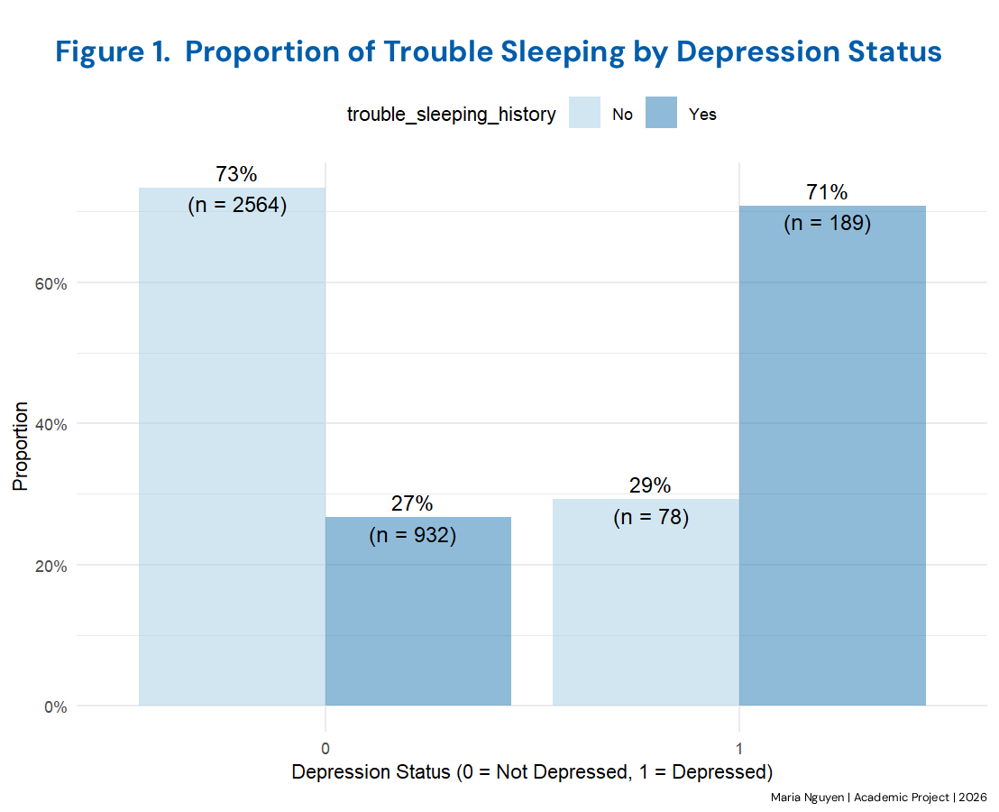
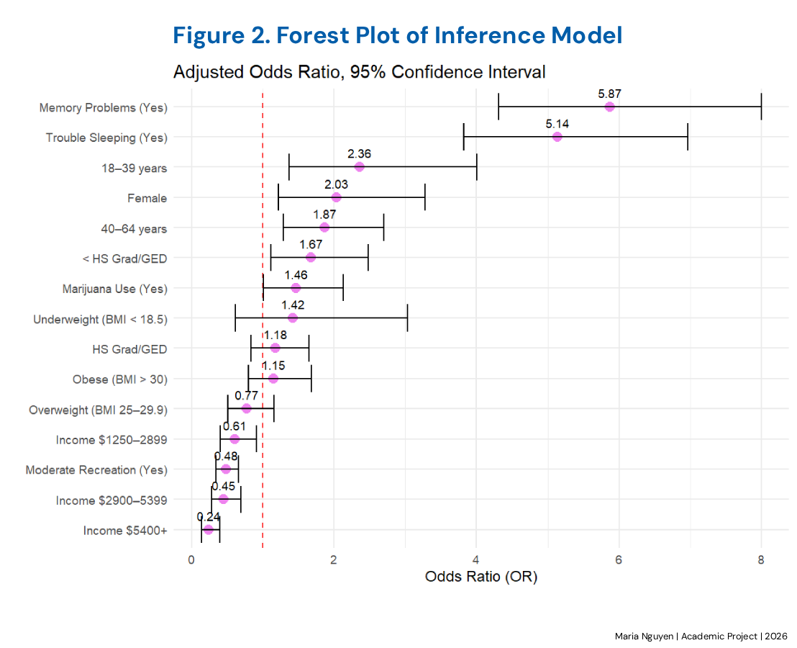
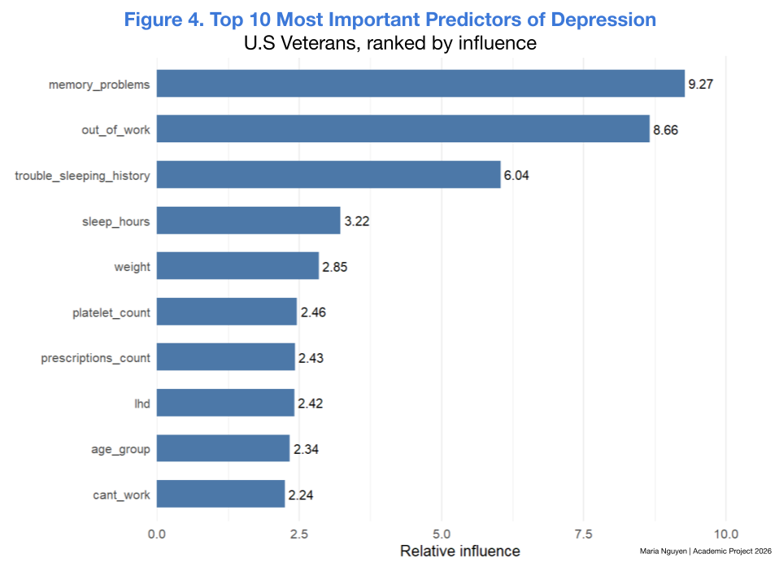

# Predicting Risk of Depression in U.S. Veterans

## Data Source:
This analysis uses publicly available data from the National Health and Nutrition Examination Survey (NHANES) between 2005-2018 (13 years). The original NHANES datasets can be accessed through the official CDC/NCHS source. 

## Sample Size:
The sample population used for analysis was 3,763 U.S. veterans (n = 3763).

## Research Questions:
- Are there biological, socioeconomic, or lifestyle factors strongly associated with depression in US veterans?
- What are some risk factors of depression for U.S. veterans?
- Which machine-learning (ML) algorithms can best predict depression in U.S. veterans?

## Methods
- Data cleaning and feature preparation in R
- Multivariate analysis
- Linear and logistic regression
- Tree-based modeling
- Train-test split and cross-validation
- Model performance evaluation

## Limitations
The findings describe associations rather than causal relationships. 
Results may be affected by self-reported measures, sample size, and the characteristics of the selected NHANES sample.

## Key Findings

Trouble-sleeping history was reported by 71% of participants classified as depressed (n = 189/267), compared with 27% of those not classified as depressed (n = 932/3,496).

Key: HS Grad: High School Graduate; Moderate Recreation: physical, sports-related, or fitness activities that increase breathing or heart rate.

> Memory, sleep, work capability, and recreational activity are significantly associated with depression in the analyzed sample. Participants with a history of trouble sleeping had 5.14 higher odds of depression (OR = 5.14, 95% CI [3.820, 6.961]). In addition, participants who engaged in moderate recreational activity had 52% lower odds of depression, consists of  (OR = 0.48, 95% CI [0.347, 0.664]). These associations do not establish causation.

Gradient boosting performed best among the models evaluated for predicting depression risk in this sample. On the held-out test set, it achieved an AUC of 0.85, an F1 score of 0.40, and sensitivity of 0.66.
Memory-, sleep-, and work-related variables were among the most important predictors. 

## Note
This repository is a portfolio summary of a completed academic project. The full source code and dataset are not included. 
© 2026 Maria Nguyen. Academic portfolio work. Please do not submit or represent this work as your own.
