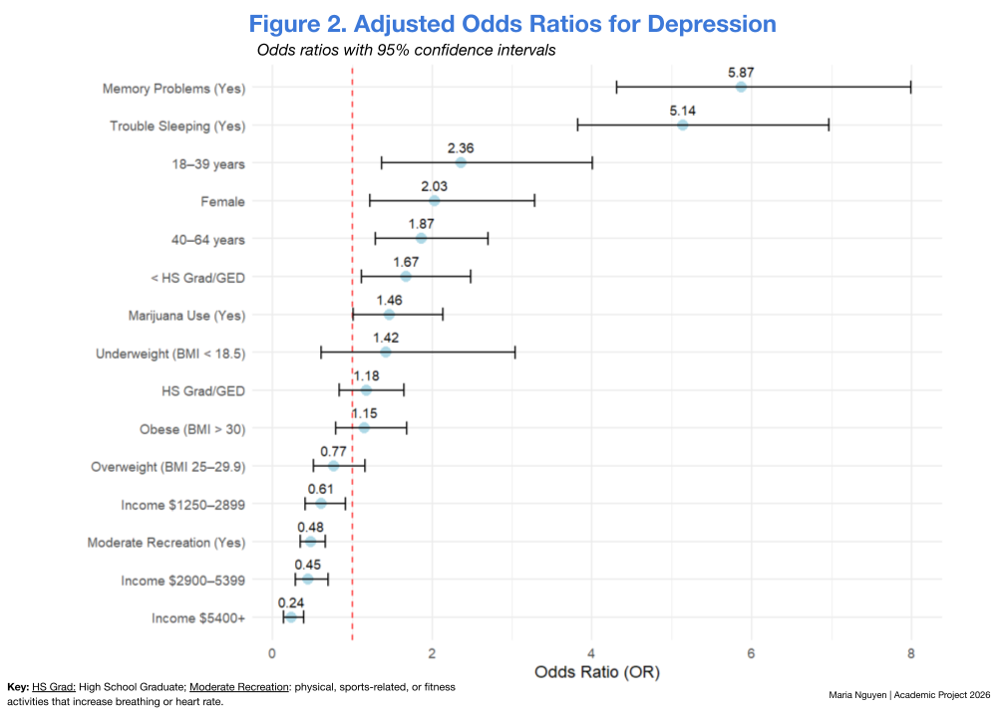
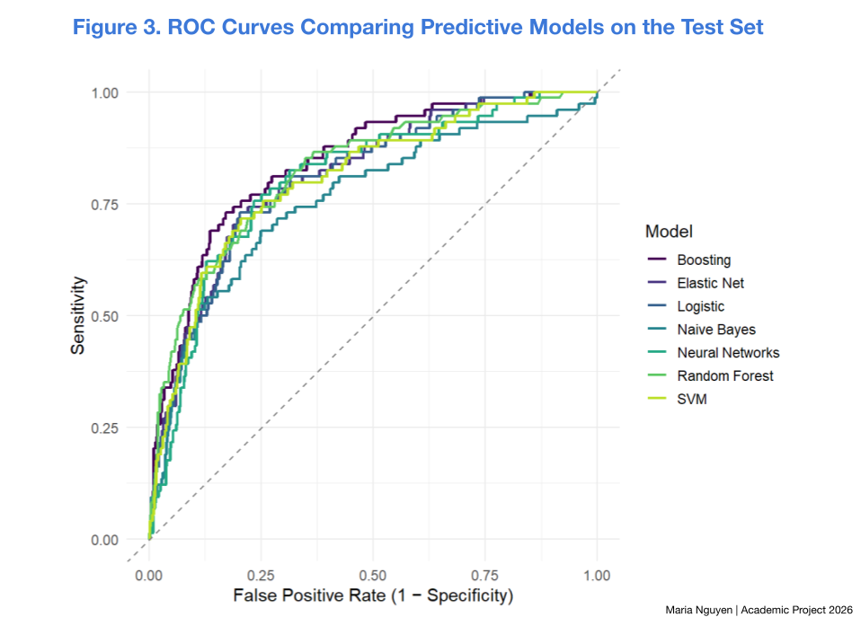
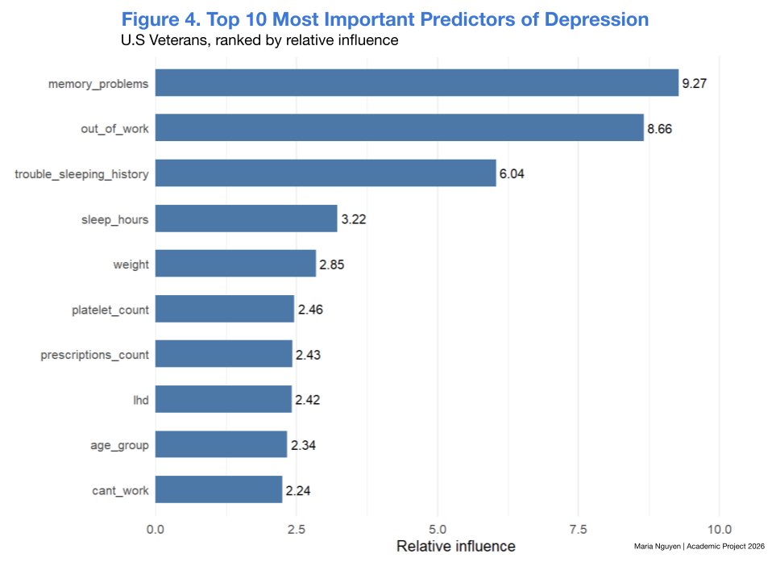

# Predicting Risk of Depression in U.S. Veterans

## Data Source and Dataset
The analysis dataset was provided as a prepared subset of publicly available NHANES data from 2005–2018. It contains 3,763 U.S. veterans (n = 3,763) and 120 variables. The original NHANES data are available from the CDC/NCHS.

## Outcome Definition
The provided dataset included a pre-coded binary depression label:
- `0` = Not Depressed (reference category)
- `1` = Depressed

The codebook did not define the criteria used to assign these labels. Therefore, this project predicts the dataset-provided classification, not a clinical diagnosis.

## Research Objectives:
1. **Examine factors associated with depression among U.S. veterans.**  
   Variables of interest include:
   - **Biological:** sex, age, and BMI
   - **Socioeconomic:** education, marital status, income, and race
   - **Lifestyle and health:** memory problems, sleep history, alcohol use, marijuana use, and recreational activity

2. **Compare machine-learning algorithms** to identify which best predict depression among U.S. veterans.

## Methods

- Data cleaning and feature preparation in R
- Multivariate analysis
- Linear and logistic regression
- Tree-based modeling
- Train-test split and cross-validation
- Model performance evaluation

## Limitations
The findings describe associations rather than causal relationships. 
Results may be affected by self-reported measures, sample size, and the characteristics of the selected NHANES sample.

## Findings

Trouble-sleeping history was reported by 71% of participants classified as depressed (n = 189/267), compared with 27% of those not classified as depressed (n = 932/3,496).

Memory, sleep, work capability, and recreational activity are significantly associated with depression in the analyzed sample. Participants with a history of trouble sleeping had 5.14 times higher odds of depression (OR = 5.14, 95% CI [3.820, 6.961]). In addition, participants who engaged in moderate recreational activity had 52% lower odds of depression, consists of  (OR = 0.48, 95% CI [0.347, 0.664]). These associations do not establish causation.

- Gradient boosting performed best among the models evaluated for predicting depression risk in this sample. On the held-out test set, it achieved an AUC of 0.85, an F1 score of 0.40, and sensitivity of 0.66.
- Memory-, sleep-, and work-related variables ranked as the most important predictors of depression risk in the model.

## Note
This repository is a portfolio summary of a completed academic project. The full source code and dataset are not included. 
© 2026 Maria Nguyen. Academic portfolio work. Please do not submit or represent this work as your own.
